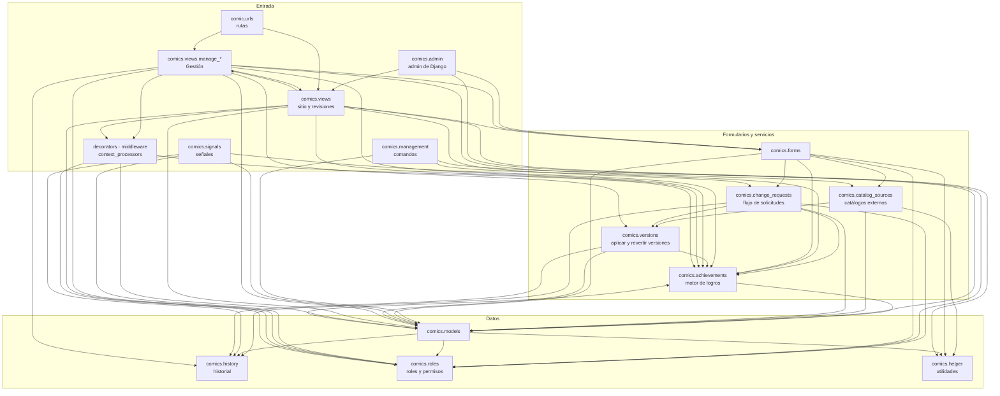
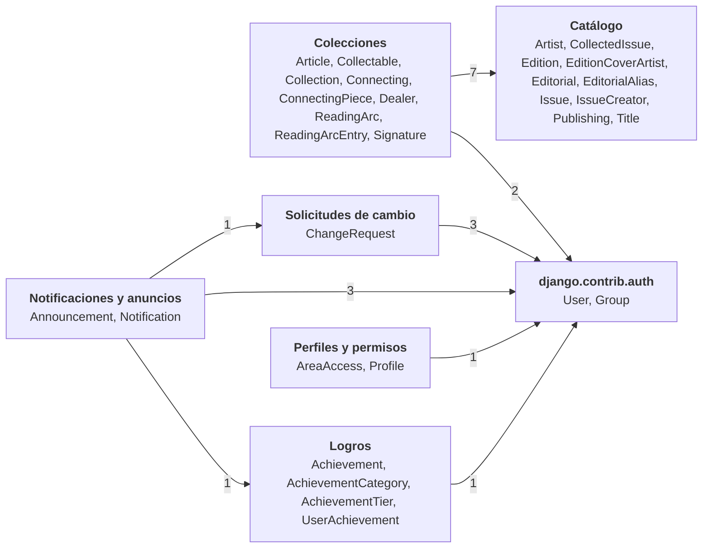
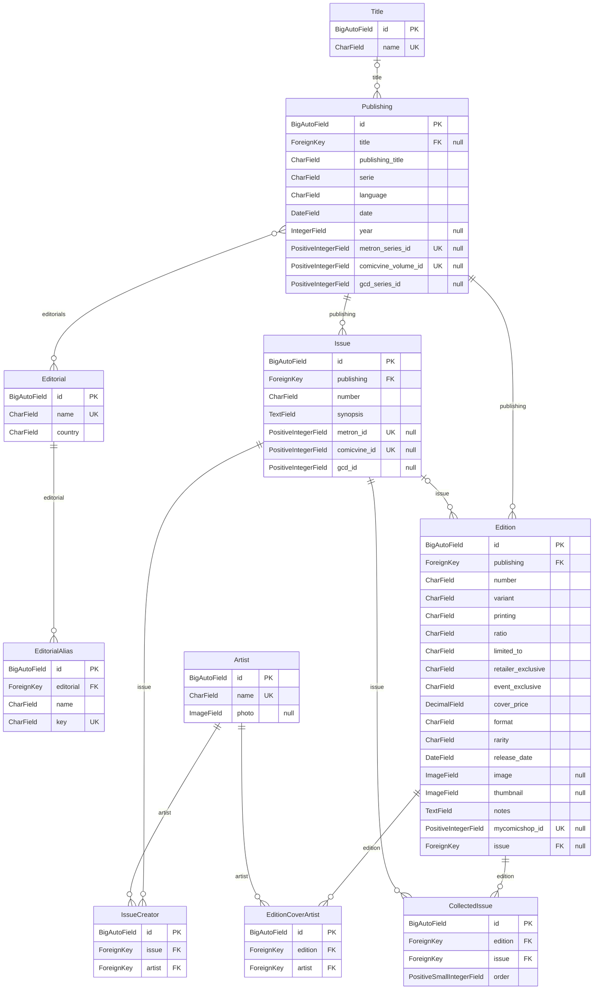
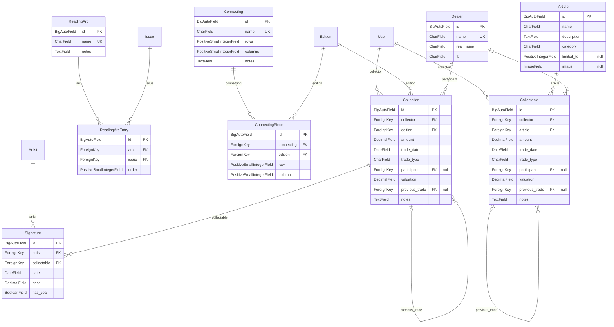
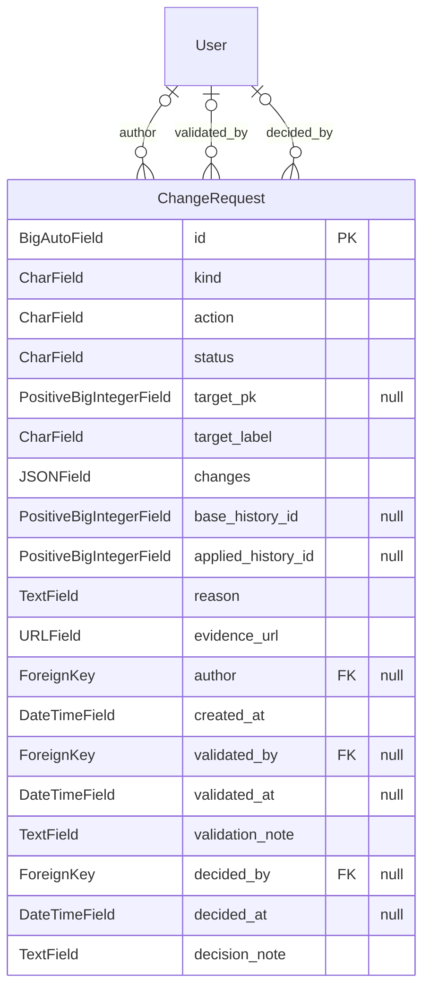
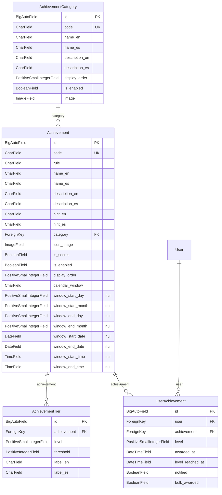
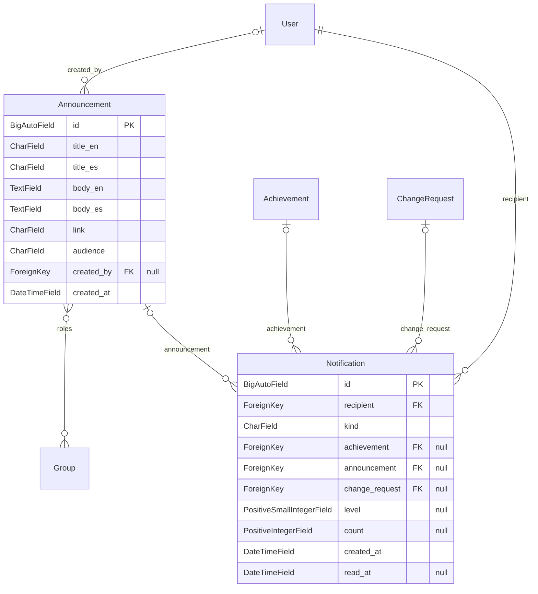
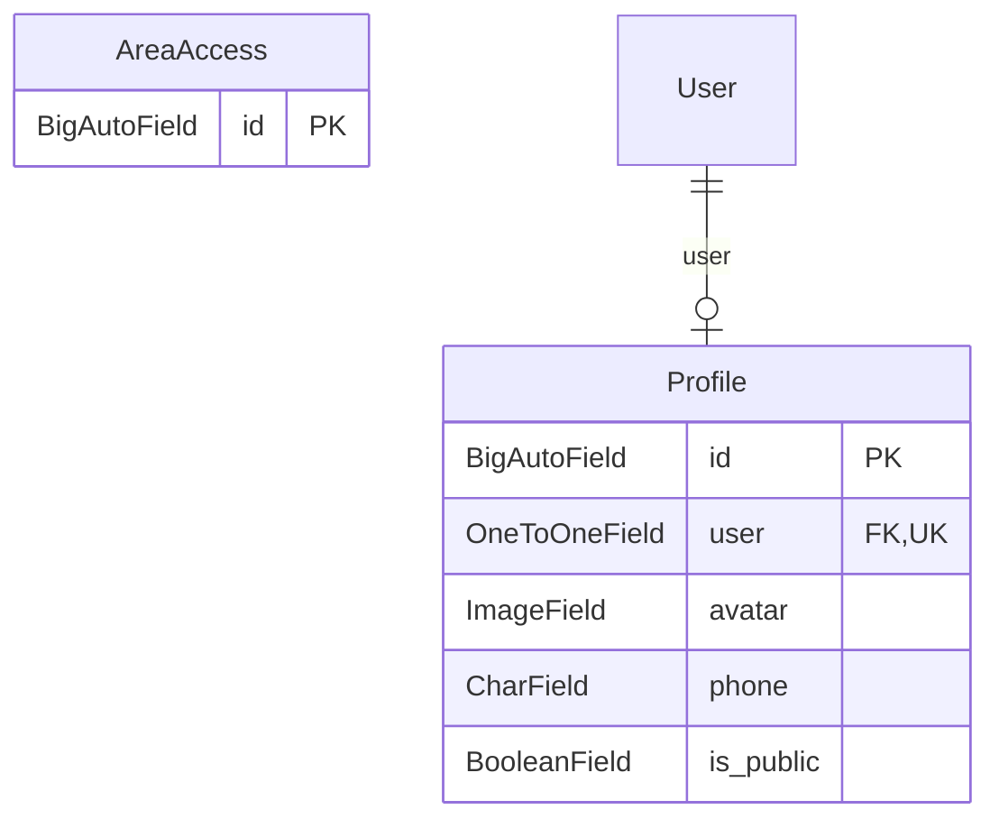

# Comi

Aplicación web para catalogar cómics y llevar el registro de una colección. Tiene un **catálogo
compartido** de editoriales, series, números y ediciones. Sobre él, cada coleccionista registra sus
**compras y ventas**, las firmas de sus piezas y lo que le falta. Los usuarios pueden **proponer
correcciones** al catálogo, que pasan por revisión antes de aplicarse. Además hay **logros**,
**perfiles** y **notificaciones**.

Está hecha con Django 5.1 (Python 3.11) y MySQL 8, y se levanta con Docker Compose. La interfaz está
en español e inglés.

**Contenido:** [Funcionalidades](#funcionalidades) · [Conceptos del catálogo](#conceptos-del-catálogo) ·
[Roles y áreas](#roles-y-áreas) · [Arquitectura](#arquitectura) · [Esquema de datos](#esquema-de-datos) ·
[Requisitos previos](#requisitos-previos) · [Instalación](#instalación) ·
[Respaldos](#respaldar-la-base-de-datos) · [Logros](#logros) · [Traducciones](#traducciones-español--inglés) ·
[Desarrollo](#desarrollo)

## Funcionalidades

- **Catálogo** de editoriales, títulos, publishings, issues, ediciones (variantes, reimpresiones,
  compilaciones) y artistas. Se mantiene desde **Gestión**, un área propia separada del admin de
  Django.
- **Importación desde catálogos externos:** el formulario de ediciones de Gestión se puede precargar
  desde [Metron](https://metron.cloud) (fuente principal), [Comic Vine](https://comicvine.gamespot.com)
  (respaldo) o [MyComicShop](https://www.mycomicshop.com), para las variantes que no están en los otros
  dos (incentivos, exclusivas de tienda o convención…): con el `TID` de la serie se abre un modal con
  todas sus portadas, se elige una y se rellenan variante, ratio, impresión, tirada y exclusivas.
  Desde los mismos diálogos se crean el publishing, el título, la editorial y los
  artistas que falten. Las editoriales tienen alias para emparejar los nombres de cada fuente.
- **Colección personal** ("Mis comics"): compras y ventas de cada edición (con vendedor, precio y
  valoración), firmas de artistas, lo que se tiene y lo que falta de cada publishing. También
  **arcos de lectura** (issues en orden, de varias series), **connectings** (portadas que forman una
  imagen mayor) y **collectables** (figuras, prints, pines...: un catálogo de artículos
  compartido y las piezas que compra o vende cada coleccionista).
- **Historial de versiones** de issues y ediciones: cada guardado es una versión (quién, cuándo,
  motivo), sea cual sea su origen. Cualquier versión se puede restaurar desde Gestión.
- **Solicitudes de cambio:** los coleccionistas proponen correcciones o altas de issues y ediciones;
  los revisores las validan y los administradores las aprueban. Al aprobarse se aplican como una
  versión más del historial. El autor recibe un aviso en cada paso.
- **Logros** con niveles, categorías y ventanas de tiempo. La regla de cada logro está en el código;
  textos, íconos, niveles y categorías se editan en Gestión.
- **Perfiles** públicos o privados con avatar y logros, **notificaciones** (campana de la barra
  superior) y **anuncios** de Gestión a todos o a ciertos roles.

## Conceptos del catálogo

| Concepto | Qué es |
| --- | --- |
| **Editorial** | La casa que publica (Marvel, DC, Panini…). Puede tener alias con los nombres que le dan Metron o Comic Vine. |
| **Title** | Un nombre que agrupa varios publishings, por ejemplo los volúmenes de una misma cabecera. |
| **Publishing** | Una serie concreta: nombre, volumen (`serie`), idioma, año de inicio y editoriales. Es lo que Metron llama *series* y Comic Vine *volume*. |
| **Issue** | El contenido de un número (la historia): número, sinopsis y creadores. Es único por publishing y número. |
| **Edition** | La pieza física, lo que se suele llamar "un cómic": portada o variante, impresión, formato, precio de portada, fecha de salida e imagen. Apunta al issue que contiene; si es una compilación, a varios issues en orden. Puede pertenecer a un publishing distinto al del issue (reediciones, ediciones extranjeras). |
| **Artist** | Creadores del interior (`IssueCreator`) y artistas de portada (`EditionCoverArtist`). No se puede borrar mientras tenga créditos. |
| **Collection** | Una compra o una venta de una edición por un coleccionista. Una venta apunta a la compra que cierra (`previous_trade`). |

## Roles y áreas

Los roles son grupos de Django; las vistas comprueban permisos, nunca nombres de grupo
(`comics/roles.py`). Se recrean con `manage.py ensure_roles`.

| Rol | Puede |
| --- | --- |
| **Collectors** | Todo usuario registrado: su colección, perfil, notificaciones y proponer cambios. |
| **Reviewers** | Además, validar o rechazar solicitudes en el área de revisión. |
| **Administrators** | Además, entrar en Gestión y aprobar solicitudes. |
| Superusuarios | Todo lo anterior y el admin de Django, que es solo para ellos. |

| Ruta | Área |
| --- | --- |
| `/comics/` | Mis comics: colección, ediciones, arcos, connectings y solicitudes propias |
| `/collectables/` | Collectables propios (las piezas que se conservan) |
| `/perfil/`, `/u/<usuario>/` | Perfil propio y perfiles de otros usuarios |
| `/notificaciones/` | Notificaciones |
| `/revisiones/` | Cola de revisión de solicitudes (Reviewers y Administrators) |
| `/gestion/` | Gestión: catálogo, colecciones, arcos, connectings, historial, logros y anuncios (Administrators) |
| `/admin/` | Admin de Django (superusuarios) |

## Arquitectura

Es un proyecto Django con una sola app, `comics`; `comic/` contiene la configuración y las rutas.

| Ruta | Contenido |
| --- | --- |
| `comics/models/` | Modelos, un módulo por área (ver [Esquema de datos](#esquema-de-datos)) |
| `comics/forms/` | Formularios, también por área |
| `comics/views/` | Vistas; las de Gestión empiezan por `manage_` |
| `comics/history.py`, `comics/versions.py` | Historial de versiones y servicios para aplicar cambios y revertirlos |
| `comics/change_requests.py` | Flujo de las solicitudes de cambio (transiciones, permisos y avisos) |
| `comics/catalog_sources/` | Clientes de Metron, Comic Vine y MyComicShop, y el mapeador que convierte sus respuestas en una propuesta para el formulario |
| `comics/achievements/` | Motor de logros: reglas, ventanas de tiempo, evaluación y presentación |
| `comics/roles.py`, `comics/decorators.py` | Roles, permisos y control de acceso a las vistas |
| `comics/signals.py` | Receptores de señales: rol y perfil de cada usuario nuevo, re-evaluación de logros y versiones de las compilaciones |
| `comics/management/commands/` | Comandos: `ensure_roles`, `ensure_achievements`, `award_achievements`, `diagrams` |
| `comics/templates/`, `comics/static/` | Plantillas (Bootstrap) y JS propio en `static/js/custom/` |
| `locale/es/` | Traducción al español |

### Dependencias entre módulos

Una flecha `A --> B` significa que algún módulo de A importa uno de B. Se calcula a partir de los
`import` del código, incluidos los que están dentro de funciones.

<!-- diagrams:modules:start -->

<!-- diagrams:modules:end -->

## Esquema de datos

Generado a partir de los modelos de `comics`. `User` y `Group` son los de `django.contrib.auth`.
En cada diagrama, las entidades que aparecen sin atributos pertenecen a otra área.

<!-- diagrams:schema:start -->
### Vista general

Cada caja es un módulo de `comics/models/`; una flecha indica que los modelos de un área tienen relaciones hacia otra (el número es cuántas).



Tienen historial de versiones (`django-simple-history`, tablas `Historical*`, que no se dibujan): `Edition` (con collected_issues, cover_artists), `Issue` (con creators).

### Catálogo



### Colecciones



### Solicitudes de cambio



### Logros



### Notificaciones y anuncios



### Perfiles y permisos


<!-- diagrams:schema:end -->

### Regenerar los diagramas

Los diagramas de este README los escribe el comando `diagrams`, que reemplaza el texto entre los
marcadores `<!-- diagrams:...:start/end -->`. No necesita la base de datos ni Docker:

```bash
.venv/Scripts/python.exe manage.py diagrams --settings=comic.settings_test
```

Hay que correrlo después de cambiar modelos o imports entre módulos. Con `--check` no escribe nada y
falla si algún diagrama está desactualizado. GitHub y la vista previa de VS Code (con la extensión
*Markdown Preview Mermaid Support*) dibujan los bloques `mermaid`.

## Requisitos previos

Antes de levantar el proyecto crea, en la raíz del repo, un archivo `mysql.env` (usado por el servicio `db` de docker-compose) con estas variables:

```
MYSQL_DATABASE=comic
MYSQL_ROOT_PASSWORD=<password root>
MYSQL_USER=<usuario de la app>
MYSQL_PASSWORD=<password del usuario>
```

Opcionalmente puedes crear un `.env` en la raíz con `COMPOSE_PROJECT_NAME=<nombre>` para fijar el nombre del proyecto de Docker Compose. Ninguno de los dos archivos se sube al repositorio (están en `.gitignore`).

El mismo `.env` (opcional) se carga en el servicio `web` con las credenciales de los catálogos externos que usa la importación del formulario de ediciones de Gestión. Sin ellas esas dos fuentes aparecen desactivadas en el selector (MyComicShop no necesita clave); con cambios en `.env` hay que recrear el contenedor (`docker compose up -d web`):

```
METRON_USERNAME=<usuario de metron.cloud>
METRON_PASSWORD=<contraseña de metron.cloud>
COMICVINE_API_KEY=<API key de Comic Vine>
```

Ojo: **todas** las variables de `.env` (también `COMPOSE_PROJECT_NAME` y cualquier otra que se añada) llegan como variables de entorno al contenedor `web`; no pongas en ese archivo nada que la app no deba ver. La sintaxis larga de `env_file` (`path` + `required: false`) necesita Docker Compose 2.24 o posterior.

## Instalación

Levanta el proyecto (esto construye la imagen del servicio `web` automáticamente, no hace falta un `docker build` manual aparte):

```bash
docker compose up --build
```

En el primer arranque, aplica las migraciones y crea un superusuario para poder entrar al admin:

```bash
docker compose exec web python manage.py migrate
docker compose exec web python manage.py createsuperuser
```

La app queda disponible en `http://localhost:8080/` y el admin en `http://localhost:8080/admin/`.

## Respaldar la base de datos

Para generar un respaldo (`dumpdata`) y copiarlo directamente a tu equipo, desde la raíz del repo en PowerShell:

```powershell
.\scripts\backup-db.ps1
```

El script valida que el contenedor esté corriendo, genera el dump dentro del contenedor `web`, lo copia a `.\backups\` con un nombre `dump-<fecha>.json`, limpia el archivo temporal del contenedor y conserva únicamente los últimos 10 respaldos locales (configurable con `-Keep`). También puedes elegir otra carpeta de destino con `-OutputDir`:

```powershell
.\scripts\backup-db.ps1 -OutputDir D:\backups\comi -Keep 20
```

Si prefieres generarlo manualmente dentro del contenedor:

```bash
docker compose exec web python dump.py
```

## Restaurar un dump

```bash
docker compose exec web python manage.py loaddata /code/dump-<fecha>.json
```

Si el archivo está solo en tu equipo (por ejemplo, uno generado con `backup-db.ps1`), primero cópialo dentro del contenedor:

```powershell
docker compose cp .\backups\dump-<fecha>.json web:/code/dump-<fecha>.json
```

Un dump solo se puede cargar en una base con el mismo esquema que tenía la base de origen. En particular, **un dump tomado antes de la migración `0100`** (categorías de logros como filas, reglas y ventanas de tiempo) no se puede cargar en una base ya migrada: guarda la categoría de cada logro como texto y no trae las columnas nuevas. Para restaurarlo, deja la base en la migración que tenía el origen, carga el dump y luego aplica el resto de las migraciones, que convierten los datos:

```bash
docker compose exec web python manage.py migrate comics 0099
docker compose exec web python manage.py loaddata /code/dump-<fecha>.json
docker compose exec web python manage.py migrate
```

Lo mismo pasa con **un dump tomado entre las migraciones `0107` y `0111`**: la `0112` renombró los modelos del historial de artistas de portada y creadores (`historicaledition_cover_artists` → `historicaleditioncoverartist`, `historicalissue_creators` → `historicalissuecreator`), así que ese dump se carga con la base en `0111` (`migrate comics 0111`, `loaddata`, `migrate`).

Volver a `0099` descarta lo que solo existe en el esquema nuevo (categorías editadas, ventanas de tiempo, reglas de logros creados en Gestión): saca antes el respaldo SQL de la base de destino. (Sobre una base vacía: `migrate comics 0099` crea las tablas hasta ese punto. Para saber en qué migración estaba el origen, busca la última de `comics` en su tabla `django_migrations`, o la fecha del dump frente a la de la migración.)

Si aparece un error de integridad de datos al restaurar, limpia las tablas existentes antes de reintentar:

```bash
docker compose exec web python manage.py flush
```

Los roles de usuario (grupos Collectors, Reviewers y Administrators) viajan dentro del dump. Si el dump es anterior a los roles, o si hiciste `flush` y el dump no los trae, vuelve a crearlos después de `loaddata` (se puede correr las veces que sea, no duplica nada):

```bash
docker compose exec web python manage.py ensure_roles
```

Crea los tres grupos con sus permisos, mete a todos los usuarios en Collectors y a los superusuarios también en Administrators. No quita membresías ni permisos que ya existan.

Los logros también viajan en el dump. Si el dump es anterior a algún logro, o si hiciste `flush` y el dump no los trae, créalos y luego otórgalos según la actividad que ya existe (ambos se pueden correr las veces que sea):

```bash
docker compose exec web python manage.py ensure_achievements
docker compose exec web python manage.py award_achievements
```

Si restauras sobre una base recién migrada (que ya trae los logros sembrados por las migraciones) sin hacer `flush`, `loaddata` solo agrega y actualiza: un nivel de un logro que se borró en Gestión en la base de origen vuelve a aparecer, porque la siembra lo creó y el dump no lo borra. Para evitarlo, vuelve a borrar ese nivel en Gestión después de restaurar, o haz `flush` antes (deja la base vacía). Otra opción es borrar los niveles antes de cargar el dump, **pero solo si el dump trae niveles** (busca `"comics.achievementtier"` en el archivo): si no los trae, los logros por conteo se quedarían sin niveles y nunca se otorgarían, porque `ensure_achievements` no vuelve a crear los niveles de logros que ya existen.

```bash
grep -q '"comics.achievementtier"' dump-<fecha>.json && echo "el dump trae niveles"
docker compose exec web python manage.py shell -c "from comics.models import AchievementTier; AchievementTier.objects.all().delete()"
docker compose exec web python manage.py loaddata /code/dump-<fecha>.json
```

## Logros

Cómo se gana cada logro está en el código (`comics/achievements/rules.py`); nombre, textos, ícono, niveles con sus umbrales, si es secreto y si está activo se editan en Gestión → Logros. Cada logro nuevo llega con una migración que crea su registro.

Después de aplicar una migración que agrega logros, otórgalos a quien ya los haya ganado con su actividad previa:

```bash
docker compose exec web python manage.py award_achievements
```

Es seguro correrlo varias veces: nunca quita logros ni baja niveles. Cada usuario ve un solo aviso con el total de logros desbloqueados. Opciones: `--user <usuario>` y `--code <código>` para limitarlo.

Además, prográmalo para que corra solo una vez al día. Los logros por fecha (como «Veterano», por años de antigüedad) se revisan al iniciar sesión; con el comando programado también los reciben quienes no vuelven a iniciar sesión. Por ejemplo, con cron en Linux (todos los días a las 4:00):

```cron
0 4 * * * cd /ruta/al/proyecto && docker compose exec -T web python manage.py award_achievements
```

En Windows, con el Programador de tareas (desde PowerShell, en la raíz del repo):

```powershell
schtasks /Create /TN "Comi award_achievements" /SC DAILY /ST 04:00 /TR "cmd /c cd /d $PWD && docker compose exec -T web python manage.py award_achievements"
```

## Respaldo completo en SQL (`mysqldump`)

El respaldo JSON de arriba solo contiene los datos de Django. Para una copia exacta de toda la base (tablas, índices, restricciones e historial del admin) usa `mysqldump`. Es el respaldo que se saca antes de aplicar una migración y se guarda en `backups/` con el nombre `comic-<fecha>.sql`.

Los comandos funcionan igual en PowerShell y en bash. El archivo se genera **dentro** del contenedor `db` y luego se copia con `docker compose cp`, porque redirigir con `>` en PowerShell 5.1 guarda el archivo en UTF-16 y lo corrompe.

### Sacar el respaldo

```powershell
docker compose exec db sh -c 'mysqldump -uroot -p"$MYSQL_ROOT_PASSWORD" --single-transaction --routines --triggers "$MYSQL_DATABASE" > /tmp/backup.sql'
docker compose cp db:/tmp/backup.sql .\backups\comic-<fecha>.sql
docker compose exec db rm /tmp/backup.sql
```

`--single-transaction` toma una copia consistente sin detener la app. Para confirmar que el respaldo no quedó incompleto, la última línea del archivo debe decir `-- Dump completed`.

### Restaurar el respaldo

> **Atención:** restaurar **reemplaza toda la base actual** con el contenido del respaldo (cada tabla se borra y se vuelve a crear). Lo que se haya registrado después de sacar ese respaldo se pierde. Saca un respaldo nuevo antes de restaurar por si necesitas volver atrás.

```powershell
docker compose stop web
docker compose cp .\backups\comic-<fecha>.sql db:/tmp/restore.sql
docker compose exec db sh -c 'mysql -uroot -p"$MYSQL_ROOT_PASSWORD" "$MYSQL_DATABASE" < /tmp/restore.sql && rm /tmp/restore.sql'
docker compose run --rm web python manage.py migrate
docker compose start web
```

- Detener `web` evita que alguien guarde cambios a mitad de la restauración.
- `migrate` aplica las migraciones del código que sean más nuevas que el respaldo. Si el respaldo ya las tenía, no hace nada.

### Probar un respaldo sin tocar la base real

La base `comic_refactor` vive en el mismo contenedor `db` y sirve para ensayar. Para cargar ahí un respaldo, cambia `"$MYSQL_DATABASE"` por `comic_refactor` en el comando de restauración (no hace falta detener `web`). La primera línea la crea si todavía no existe:

```powershell
docker compose exec db sh -c 'mysql -uroot -p"$MYSQL_ROOT_PASSWORD" -e "CREATE DATABASE IF NOT EXISTS comic_refactor CHARACTER SET utf8mb4"'
docker compose cp .\backups\comic-<fecha>.sql db:/tmp/restore.sql
docker compose exec db sh -c 'mysql -uroot -p"$MYSQL_ROOT_PASSWORD" comic_refactor < /tmp/restore.sql && rm /tmp/restore.sql'
```

## Correr localmente con configuración de producción

Por defecto (`docker compose up`) el proyecto corre en modo desarrollo: `DEBUG=True`, `runserver` con autoreload y `ALLOWED_HOSTS=*`. Para levantar el mismo stack pero con la configuración que usarías en producción (`DEBUG=False`, `ALLOWED_HOSTS` restringido, gunicorn en vez de `runserver`), usa el archivo de override `docker-compose.prod.yaml`:

```bash
docker compose -f docker-compose.yaml -f docker-compose.prod.yaml up --build
```

Los estáticos se sirven igual en ambos modos (vía WhiteNoise, ya recolectados en la imagen con `collectstatic` durante el build), así que no hay diferencia de comportamiento ahí entre desarrollo y este modo "producción" local.

Antes de un despliegue real, además define `DJANGO_SECRET_KEY` con un valor propio (el `SECRET_KEY` por defecto en `settings.py` está expuesto en el historial del repo) y ajusta `DJANGO_ALLOWED_HOSTS` al dominio real.

## Traducciones (español / inglés)

El idioma se elige desde el botón de traducción en la barra superior y se guarda en una cookie. Sin elección previa se usa el idioma del navegador si es español o inglés; si no, español.

Los textos de la interfaz se escriben en **inglés** en el código (`` en plantillas, `gettext` en Python y en JS) y su traducción al español vive en `locale/es/LC_MESSAGES/`: `django.po` para Python y plantillas, `djangojs.po` para JavaScript. Al agregar o cambiar textos:

1. Extrae los textos nuevos a los `.po`:
   ```bash
   MSYS_NO_PATHCONV=1 docker compose run --rm -v "$(pwd -W):/code" web sh -c 'python manage.py makemessages -l es --no-wrap -i staticfiles -i media -i backups -i "comics/static/vendor/*" && python manage.py makemessages -d djangojs -l es --no-wrap -i staticfiles -i media -i backups -i "comics/static/vendor/*"'
   ```
2. Escribe la traducción en cada `msgstr` vacío de los `.po`.
3. Reconstruye la imagen (`docker compose up --build`): el build compila los `.po` a `.mo` con `compilemessages`. Los `.mo` no se versionan.

## Desarrollo

- **Ramas:** `master` es lo desplegado, `develop` la integración; las features salen de `develop` en
  ramas `feat/...` o `fix/...`.
- **Tests:** contra MySQL, dentro de Docker. Desde Git Bash, el árbol de trabajo se monta con
  `MSYS_NO_PATHCONV=1` y una ruta de Windows; con un `-v "$(pwd):/code"` normal no se monta nada y
  los tests corren con el código que tiene la imagen:
  ```bash
  MSYS_NO_PATHCONV=1 docker compose run --rm -v "$(pwd -W):/code" web sh -c 'MYSQL_USER=root MYSQL_PASSWORD="$MYSQL_ROOT_PASSWORD" python manage.py test comics --noinput'
  ```
  Sin Docker se pueden correr sobre SQLite en memoria, pero MySQL es la referencia para las
  migraciones: `.venv/Scripts/python.exe manage.py test comics --settings=comic.settings_test`.
- **Estilo:** Ruff (`ruff check` y `ruff format`, configurado en `pyproject.toml`). Los comentarios y
  docstrings van en inglés.
- **Commits:** [Conventional Commits](https://www.conventionalcommits.org/en/v1.0.0/), en inglés.
- **Pendientes:** el trabajo pendiente, las decisiones abiertas y las limitaciones conocidas están en
  [`BACKLOG.md`](BACKLOG.md).

## Notas

- Si ves un error del estilo `failed to solve: invalid file request mysql_volume/mysql.sock`, es porque quedó un volumen de MySQL corrupto. Bájalo y elimina el volumen con `docker compose down -v` y vuelve a levantar el proyecto (esto borra los datos de la base local).
- El contenedor `web` corre como usuario sin privilegios (`app`). Si ya tenías un `media_volume` creado por una versión anterior de la imagen (donde corría como `root`), la primera vez que actualices vas a necesitar arreglar los permisos una sola vez:
  ```bash
  docker compose exec --user root web chown -R app:app /code/media
  ```
